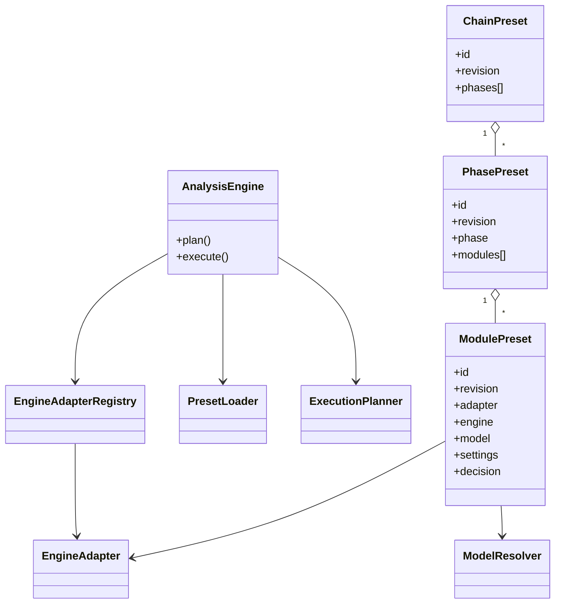

# Analysis Engine V2A — UML / architecture



## Flux

```text
PhasePreset JSON
      │
      ▼
PresetLoader ── schema/contract validation
      │
      ▼
ExecutionPlanner ── ordre déterministe
      │
      ▼
AnalysisEngine
      │
      ├── AdapterRegistry ── adapter technique ── moteur / modèle
      │
      └── Provenance ── hashes + versions + ordre effectif
      │
      ▼
PhaseExecution
```

V2A ne remplace pas encore le runner PROFILE. Il introduit le socle exécutable et
le Preset de compatibilité. V2B effectuera le branchement PROFILE + comparaison
stricte contre le run #78.
